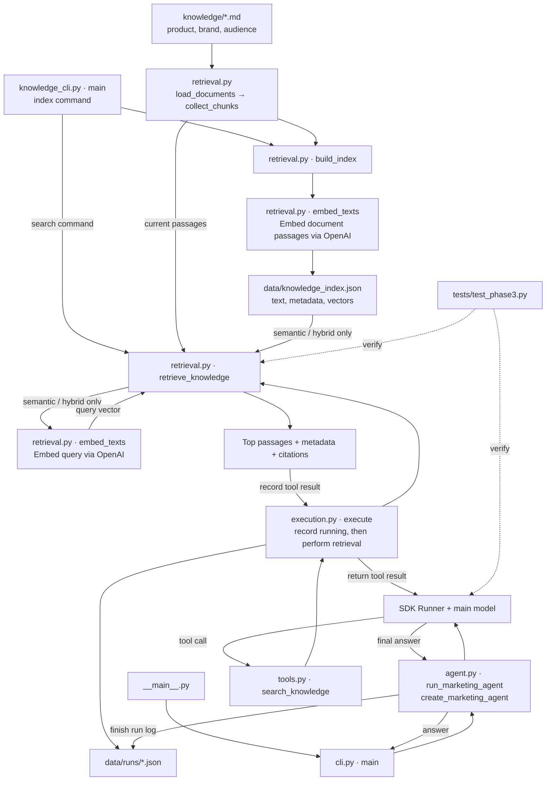
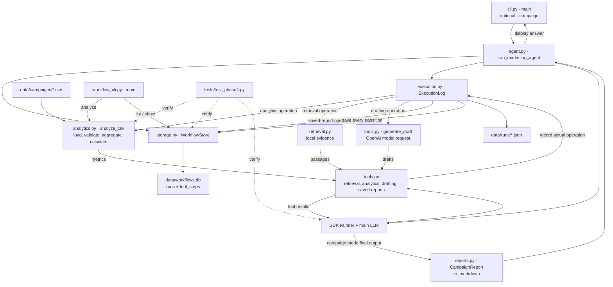

# MarketPilot AI

MarketPilot AI is a command-line marketing agent that chooses tools, uses their
results, and produces marketing drafts or answers grounded in retrieved evidence.

## What it can do

- Research competitors, audiences, and trends using web search with citations.
- Draft advertising copy, headlines, blog outlines, social posts/calendars, and promotional emails.
- Retrieve product facts and brand guidance from a local Markdown knowledge base
  using keyword, semantic, or hybrid search.
- Combine retrieval/research and drafting in one request, with actual tool progress
  and inspectable JSON execution logs.
- Calculate campaign CSV metrics with pandas, produce structured campaign reports,
  and save workflow state and results in SQLite for later inspection.
- Connect a real local MCP server and inspect tools, resources, and prompts.
- Inspect architecture and actual execution diagrams in a Streamlit dashboard,
  inspect individual steps, and export diagrams and reports.

**Current scope:** phases 1–6 are implemented. Email and social content are draft-only.
There is no automatic conversation memory, automatic resume, subagents, or plugin
packaging. The sample knowledge describes **StudySprint, a fictional demo
product**. Research and retrieval results still need source review.

## Setup

Use Python 3.11+; the commands below use Python 3.12 and zsh on macOS.

```sh
python3.12 -m venv .venv
source .venv/bin/activate
python -m pip install -e '.[dev]'

# Enter your key privately; do not commit it or paste it into chat.
read -rs 'OPENAI_API_KEY?OpenAI API key: '
export OPENAI_API_KEY
```

`pyproject.toml` declares direct dependencies. `requirements.txt` freezes the
installed Python 3.12 environment, including test and transitive dependencies:

```sh
python -m pip install -r requirements.txt
python -m pip install -e '.[dev]'
```

To refresh that snapshot after installing dependencies, use
`python -m pip freeze --exclude marketpilot-ai > requirements.txt`.
The exclusion avoids recording a machine-specific editable project path.

## Run and example prompts

Start the dashboard from the shell where your API key is set:

```sh
python -m streamlit run app.py
```

Open the displayed localhost URL. Workspace runs the same agent as the CLI;
Workflow visualizer shows architecture and recorded execution. Focus mode
hides settings for a larger workflow inspection area. Without a key, use **Run local demo — no LLM**:
it executes real retrieval, analytics, and MCP operations, without autonomous
planning or generated content. It is explicitly labeled throughout.

For implementation details, see [docs/WORKFLOW_GUIDE.md](docs/WORKFLOW_GUIDE.md).

Put any request in quotes:

```sh
python -m marketpilot "Draft three headlines for a productivity app targeting university students."
```

| Task | Example prompt |
| --- | --- |
| Research | Research two current competitors for student productivity apps and cite sources. |
| Ads or blog outlines | Draft two ads and one blog outline for a student productivity app. State assumptions. |
| Social calendar | Create a 3-day Instagram content calendar for a student productivity app. |
| Email | Draft a friendly promotional email for a student productivity app. Use placeholders for unknown offers. |
| Local knowledge | Use search_knowledge in keyword mode to list StudySprint's supported features. Cite sources and label it fictional. |
| Combined request | Research competitors, create a 3-day Instagram calendar, and draft a promotional email for a student productivity app. |
| Analytics | Analyze sample_campaign.csv and compare channels by cost per conversion. Label the results as fictional demo data. |
| Saved report | Read the saved report for run RUN_ID and explain its recommendations. |

The model chooses tools based on the request; these are examples, not fixed
commands. Each invocation starts independently. `--model` overrides
`MARKETPILOT_MODEL` and the default `gpt-4.1-mini`; `--quiet-tools` hides progress
messages without disabling tools or logs. Use `python -m marketpilot --help` for options.

Tool status and the log path appear in the terminal. Open `data/runs/<run-id>.json`
to inspect tool inputs, outputs, statuses, and durations. Generated logs are excluded from Git.

Use `--campaign` for a structured report, rendered as Markdown in the terminal:

```sh
python -m marketpilot --campaign "Use StudySprint knowledge in keyword mode, analyze sample_campaign.csv, and draft an improved promotional email. Cite sources, name the metric behind recommendations, and label all demo data as fictional."
```

Inspect analytics or saved runs without an API call:

```sh
python -m marketpilot.workflow_cli analyze sample_campaign.csv
python -m marketpilot.workflow_cli list
python -m marketpilot.workflow_cli show RUN_ID
```

Replace `RUN_ID` with an ID from `list` or the printed JSON log filename.
`analyze` prints metrics only; it does not create an agent run. Agent runs save
status, tool steps, final Markdown, and any structured report to `data/workflows.db`.

## Knowledge search

Inspect local passages without running the marketing agent:

```sh
# Keyword search needs no API key or index.
python -m marketpilot.knowledge_cli search "StudySprint supported features" --mode keyword

# Build real embeddings before semantic/hybrid search or default agent retrieval.
python -m marketpilot.knowledge_cli index
python -m marketpilot.knowledge_cli search "help students organize coursework" --mode semantic
python -m marketpilot.knowledge_cli search "StudySprint brand voice" --mode hybrid
```

Indexing uses `text-embedding-3-small` and saves `data/knowledge_index.json` locally.
Rerun `index` after changing documents; unchanged indexes are reused. Semantic and
hybrid searches embed each query. Their default is hybrid; keyword searches use
current Markdown directly. The knowledge CLI prints evidence, while an agent
request generates an answer from that evidence.

## Test and validation

```sh
python -m pytest -q
python -m pip check
```

All 57 tests passed. Tests use mocked API/model responses and do not spend
credits. Phase 1 has a verified live response; Phase 2 live tool calls and Phase 3
live embeddings/RAG, and Phase 4 live agent workflows still need verification
from an API-enabled terminal. Local analytics and SQLite persistence are verified.
See [PROJECT_PROGRESS.md](PROJECT_PROGRESS.md) for status and
[REQUIREMENTS.md](REQUIREMENTS.md) for the planned visualizer.

## Build walkthrough by phase

### Phase 1 — Setup and First Agent

- Created a Python package and an isolated Python 3.12 virtual environment.
- Installed and configured the OpenAI Agents SDK.
- Defined the first Marketing Agent with marketing instructions and
  `gpt-4.1-mini` as its default model.
- Built a CLI that accepts a request and an optional model override, runs the
  agent, and prints its response.
- Configured API authentication through `OPENAI_API_KEY`.
- Added input validation and clear messages for common API errors.
- Added four offline tests; all passed, and the dependency check passed.
- Verified a real API request in the local terminal: a request for a student
  productivity app headline returned a generated headline.
- Added `.gitignore`, project requirements, and progress documentation; committed
  and pushed the Phase 1 checkpoint to GitHub.

The request flow is:

1. `marketpilot/cli.py` reads your request and optional model override.
2. `marketpilot/agent.py` validates the request and checks that a key is present.
3. `Agent` describes the assistant: name, instructions, and model.
4. `Runner.run()` sends the request and instructions to the model through the SDK.
5. The LLM creates a marketing response; Python prints `result.final_output`.

The SDK is the runtime/harness: it manages model interactions and, once we add
tools, the repeated model → tool → model loop. System instructions guide the
model's behavior; they are not executable Python or a hard security boundary.
There are no publishing tools, so this application cannot send emails or post.
Remote SDK tracing is disabled for this first exercise.

Phase 1 has no tools, live research, retrieval, CSV analysis, persistence, MCP,
subagents, or dashboard. General marketing suggestions are not verified market
research. We will collect actual tool execution events in Phase 2 and build the
workflow visualizer in Phase 6.

### Why the interface and agent logic are separate

`cli.main()` reads terminal arguments and prints the answer in the terminal.
The future Streamlit dashboard will read a web textbox and display the answer
on a webpage. It should call `run_marketing_agent()` directly rather than call
`cli.main()`, because terminal argument parsing does not belong in the dashboard.

Both interfaces can reuse the same agent logic:

```text
Terminal → cli.py ───────┐
                        ├→ run_marketing_agent() → SDK → LLM
Web page → Streamlit ───┘
```

The Streamlit path is planned for Phase 6; only the terminal interface exists now.

### Phase 2 — Tools and Marketing Features

- Added four real SDK function tools: `research_market`, `generate_content`,
  `create_social_posts`, and `draft_email`.
- Added live web research through OpenAI's hosted web search, requiring a
  completed search and cited summary. API-provided citations and search actions
  are preserved in the tool output.
- Added focused drafting prompts and a Pydantic output schema. Content variants
  are limited to 1–5 and social calendars to 1–7 days. All content stays draft-only.
- Connected tools to the main agent so the model can choose calls and consume
  their results; tool calls are configured to run sequentially.
- Added terminal status messages and JSON execution records for the future visualizer.
- Increased the main runner limit from 3 to 8 model turns and added SDK error handling.
- Passed 14 offline tests, including the real SDK model → tool → model loop with
  an explicitly scripted test model. Live Phase 2 API verification remains pending.

#### How a tool request works

1. The main LLM sees your request, instructions, and tool schemas.
2. It chooses a tool and produces JSON arguments. `@function_tool` derives the
   tool schema from the Python signature and docstring; the SDK validates arguments.
3. The SDK invokes the Python function. Its local context contains the run log
   and model name; the LLM does not supply this context.
4. Python records the running state and calls the relevant API operation.
5. Python records the result or failure and measured duration.
6. The SDK sends the tool result back to the main LLM, which can request another
   tool or compose a final answer. The runner stops when it receives a final answer.

The drafting tools use focused model calls to produce reusable structured drafts.
They are not separate agents or handoffs. Each drafting tool adds an API request;
web research also uses hosted search and its associated API charges. Research
is a web-sourced synthesis, not a guarantee that every claim is correct.
The 8-turn limit counts calls made by the main agent's runner; the focused API
calls inside tools are separate and do not count toward that limit.

#### Phase 2 code guide

| File | Functions or classes | Purpose |
| --- | --- | --- |
| `marketpilot/tools.py` | `DraftItem`, `DraftOutput` | Define the structured draft fields: title, labeled text items, and assumptions. |
| `marketpilot/tools.py` | `generate_draft()` | Call the Responses API with a focused prompt, parse the schema, and validate the item count. |
| `marketpilot/tools.py` | `search_market()` | Require hosted search and return its summary, citations, and search actions. |
| `marketpilot/tools.py` | `research_market()` | Expose and log the research operation as a function tool. |
| `marketpilot/tools.py` | `generate_content()` | Validate the variant count and draft ads, headlines, or blog outlines. |
| `marketpilot/tools.py` | `create_social_posts()` | Validate the calendar length and draft one post per day for a platform. |
| `marketpilot/tools.py` | `draft_email()` | Draft subject, preview text, body, and call to action. |
| `marketpilot/execution.py` | `utc_now()`, `redact()` | Produce UTC timestamps and mask API keys in saved text. |
| `marketpilot/execution.py` | `ExecutionLog.__init__()` | Create a unique run record and save its initial state. |
| `marketpilot/execution.py` | `emit()`, `save()` | Send progress to the interface and atomically save JSON. |
| `marketpilot/execution.py` | `execute()` | Wrap an actual tool operation with running/completed/failed events and timing. |
| `marketpilot/execution.py` | `finish()` | Save the final response or run failure and total duration. |
| `marketpilot/agent.py` | `create_marketing_agent()`, `run_marketing_agent()` | Attach tools, supply local context, and finalize the execution log. |
| `marketpilot/cli.py` | `main()` | Print progress to stderr, support `--quiet-tools`, and handle SDK/logging errors. |

The small inner `operation()` functions in content and social tools keep validation
inside the logged operation, so invalid limits are recorded as failed steps.
The lambdas defer API execution until `execute()` has saved the running event.

Run records contain a run ID, model, prompt, final output, overall status and timing,
and an ordered list of tool steps. Each step contains its own ID, tool name, inputs,
outputs, status, timestamps, duration, and error if one occurred. Ordering reflects
when operations start. Only operations entered in Python become tool steps; SDK
argument-validation failures are recorded as run failures. Hosted search actions
are preserved within research output; their individual durations are unavailable.

### Phase 3 — Knowledge Base and RAG

- Added a Markdown knowledge bundle containing fictional product facts, brand
  guidance, and audience hypotheses, each with title, status, tags, and date metadata.
- Added heading-aware chunking with 1,000-character windows and 150-character
  overlap inside long sections. Chunks retain source paths, line ranges, metadata,
  and stable IDs. Character windows keep this demonstration simple; they may split words.
- Added real OpenAI embeddings and a cached JSON vector index with stale-source detection.
- Added keyword search, semantic search using cosine similarity, and weighted
  hybrid search: 70% nonnegative semantic score plus 30% keyword score.
- Added `search_knowledge` as a logged SDK function tool. The agent can choose
  retrieval, consume passages, and cite source references before answering or drafting.
- Passed 28 offline tests in total, including a real SDK retrieval loop with a
  scripted test model. Real keyword search was verified against the sample documents.
- Live embedding requests and a live model-generated RAG answer remain unverified
  in Codex's shell because its API key is unavailable. No fake index is substituted.

#### The concepts in this implementation

**RAG** means retrieve relevant information, add it to the model's input, and
generate an answer from it. It does not train or change the model's weights.
**Embeddings** represent text as numeric vectors; cosine similarity compares
their directions. **Keyword search** matches exact words, while **semantic search**
can find related meaning with different wording. Hybrid search combines both.
Scores are ranking signals, not accuracy percentages, and top results can still
be irrelevant; the agent is instructed to acknowledge missing evidence.

This is a lightweight **agentic RAG** pattern: retrieval is a tool the agent can
choose and repeat with a more focused query. It is not an autonomous research
planner, reranker, or production retrieval system. The JSON file is a local vector
index, not a dedicated vector database. SQL retrieval belongs to a later phase.

The Markdown bundle uses a simple `---` metadata header containing single-line
`key: value` strings; tags are comma-separated text. This is a small bundle-style
demonstration, not a complete YAML parser or a claimed OKF-format implementation.
Keep source content in the body under Markdown headings. Every returned passage
includes its metadata so fictional examples remain distinguishable from real data.

#### Phase 3 files and reading order

1. `knowledge/product.md`, `brand.md`, and `audience.md`: inspect the source text
   and metadata before studying retrieval.
2. `marketpilot/retrieval.py`: follow loading → chunking → indexing → searching.
3. `marketpilot/knowledge_cli.py`: see how indexing and standalone search are invoked.
4. `marketpilot/tools.py`: read the new `search_knowledge()` wrapper.
5. `marketpilot/agent.py`: inspect the added retrieval instructions and citations policy.
6. `tests/test_phase3.py`: read the keyword test, then the index/ranking tests and SDK loop test.
7. This README and `PROJECT_PROGRESS.md`: review run commands, limitations, and validation.

| Function/class | Responsibility |
| --- | --- |
| `Document` | Hold a document's source, body, starting line, and metadata. |
| `load_documents()` | Read Markdown and its simple metadata header. |
| `chunk_document()` | Split heading sections into bounded, overlapping passages. |
| `collect_chunks()` | Load the whole knowledge directory and collect its chunks. |
| `corpus_fingerprint()` | Hash chunk content and metadata to detect changes. |
| `searchable_text()` | Combine title, tags, heading, and passage for search. |
| `embed_texts()` | Batch real embedding requests and restore input order. |
| `build_index()` | Reuse a current index or embed and atomically save a new one. |
| `validate_vectors()` | Reject empty, zero, nonfinite, or dimensionally inconsistent vectors. |
| `load_index()` | Reject missing, stale, malformed, or inconsistent cached indexes. |
| `keyword_score()` | Measure the fraction of query words present in a passage. |
| `cosine_similarity()` | Compare the query vector with a passage vector. |
| `retrieve_knowledge()` | Rank passages in the selected mode and return the top results with citations. |
| `knowledge_cli.main()` | Parse index/search commands and display results or errors. |
| `tools.search_knowledge()` | Expose retrieval to the agent and log its actual execution. |

No Phase 3 changes are needed in `execution.py`, `cli.py`, or `__main__.py`: the
existing tool logger and main runner already support another function tool.
The existing tool-registration test was updated to expect the fifth tool.
No files were deleted or dependencies added in Phase 3. Phase 7 remains unimplemented.

#### File flow

This is a learning diagram, not the Phase 6 dashboard visualizer.



### Phase 4 — Workflows and Analytics

- Added deterministic pandas CSV analytics as the `analyze_campaign` tool.
- Added optional `--campaign` reports using the SDK's Pydantic `output_type`.
  Ordinary requests retain their existing plain-text output.
- Added SQLite run/step persistence and explicit report retrieval through
  `read_saved_report`. There are now seven function tools; the main runner still
  has an eight-turn limit and chooses the tools needed for each request.
- Added offline analysis and run-inspection commands through `workflow_cli.py`.
- Added a clearly fictional sample CSV, pandas, and a frozen `requirements.txt`.
- Passed 46 tests, including a multi-step SDK workflow with real retrieval,
  pandas calculations, and SQLite persistence. Model planning and drafting in
  that test are explicitly scripted/mocked; live agent verification is pending.

#### CSV format and calculations

Put CSVs inside `data/campaigns/` and pass their filename, e.g. `sample_campaign.csv`.
The tool accepts only local CSVs within that directory, up to 5 MB and 10,000 rows.
User CSV files are ignored by Git; the fictional sample is included.

| Column | Requirement |
| --- | --- |
| `channel` | Nonempty channel name; multiple rows for a channel are summed. |
| `impressions`, `clicks`, `conversions` | Finite, nonnegative whole-number counts. This simple schema requires conversions <= clicks <= impressions. |
| `spend` | Finite, nonnegative numeric spend. |
| `revenue` | Optional; if absent, ROAS is unavailable. |
| `currency` | Optional; if supplied, every row must use the same nonempty currency. |

CTR = clicks / impressions × 100; conversion rate = conversions / clicks × 100;
CPC = spend / clicks; CPA = spend / conversions; ROAS = revenue / spend.
Zero denominators produce `null`, not zero or infinity. Counts and amounts are
summed before calculating rates; row percentages are never averaged.

The fictional sample has 25,000 impressions, 1,400 clicks, 85 conversions,
EUR 600 spend, and EUR 1,700 revenue. Its total CTR is 5.6% and CPA is EUR 7.0588.
These are demonstration numbers, not evidence of actual marketing performance.
Python computes metrics; the model interprets them. Recommendations must identify
their chosen metric and acknowledge observational-data limitations.

#### Workflow state versus conversation memory

`ExecutionLog.save()` still writes JSON and now mirrors each snapshot into SQLite
when a store is supplied. `runs` holds overall status and final results;
`tool_steps` holds ordered tool inputs, outputs, failures, and timing.
Each SQL snapshot is transactional; JSON and SQLite are separate writes, not a
single cross-file transaction. A forced process termination can leave a run marked
running; automatic recovery/resume is not implemented.

Stored reports are not automatically added to new prompts. Users can inspect them
with the workflow CLI or supply a run ID so the agent calls `read_saved_report`.
This demonstrates real SQL/structured-data retrieval using fixed parameterized
queries, not model-generated SQL. An eight-turn agent loop is bounded orchestration,
not a resumable task scheduler.

`CampaignReport` defines title, summary, knowledge, research, analytics, drafts,
recommendations, and limitations. The SDK parses that schema; Python renders
Markdown and stores both representations. Schema validation guarantees structure,
not factual accuracy or that requested tools were used; inspect the actual steps.

#### Phase 4 files and reading order

1. `data/campaigns/sample_campaign.csv`: see the input numbers.
2. `marketpilot/analytics.py`: follow loading, validation, grouping, and calculation.
3. `marketpilot/reports.py`: see the final report schema and Markdown rendering.
4. `marketpilot/storage.py`: see how runs and steps are saved and queried.
5. `marketpilot/execution.py`: inspect the optional store and SQLite call in `save()`.
6. `marketpilot/tools.py`: read `analyze_campaign()` and `read_saved_report()`.
7. `marketpilot/agent.py` and `cli.py`: trace store creation and the `--campaign` flag.
8. `marketpilot/workflow_cli.py`: inspect local analytics and saved runs without an LLM.
9. `tests/test_phase4.py`, this README, and `PROJECT_PROGRESS.md`: review verification and limits.

| Function/class | Responsibility |
| --- | --- |
| `resolve_csv()` | Restrict filenames to local campaign CSVs and check file size. |
| `load_campaign()` | Load pandas data and validate schema, counts, values, and currency. |
| `safe_ratio()` | Handle division by zero explicitly. |
| `calculate_metrics()` | Compute rates, costs, and ROAS from aggregated values. |
| `analyze_csv()` | Sum overall/channel values and return metrics, definitions, and warnings. |
| `CampaignDraft`, `CampaignReport` | Define the optional structured final response. |
| `CampaignReport.to_markdown()` | Render a validated report for terminal display. |
| `WorkflowStore.__init__()`, `_connect()` | Create SQLite tables and short-lived connections. |
| `WorkflowStore.save_run()` | Upsert a run and its steps atomically within SQLite. |
| `list_runs()`, `get_run()`, `read_report()` | Retrieve recent runs, full run details, or one saved result. |
| `analyze_campaign()` | Expose and log pandas analytics as an agent tool. |
| `read_saved_report()` | Expose and log explicit SQLite report retrieval as an agent tool. |
| `workflow_cli.main()` | Parse analyze/list/show commands without calling the LLM. |

`execution.py` adds an optional store and structured-report field; `agent.py`
creates the store and enables the report schema only in campaign mode. `cli.py`
adds the flag and handles SQLite errors. `pyproject.toml` adds pandas, and
`requirements.txt` captures the installed dependency versions. `.gitignore`
excludes user campaign data and SQLite sidecar files. Existing tests were adjusted
to isolate storage in temporary directories. No files were deleted.




### Phase 5 — MCP and Agent Customization

The application is the MCP **host**. `LoggedMCPServer` uses the Agents SDK's MCP
**client** to start `mcp_server.py` as a separate process over **stdio**. The server
exposes two real tools, a resource, and a prompt. The SDK discovers tool schemas
and can execute model-selected MCP calls; results return through the usual loop.

```sh
# Real MCP subprocess, no LLM/API key needed: discover and exercise all primitives.
python -m marketpilot.mcp_client

# Live main model with a connected MCP server and selected Markdown procedure.
python -m marketpilot --mcp --skill campaign-review --campaign "Use MCP to analyze sample_campaign.csv and recommend an improvement. Label the data fictional and explain your chosen metric."
```

`mcp_campaign_metrics` calculates CSV metrics, and `mcp_keyword_knowledge` searches
local documents. `marketpilot://brand-guide` is an application-readable resource;
`campaign_brief` is a user-selected prompt template. Resources/prompts are exercised
by the inspection command, not automatically injected into agent conversations.
Only `--mcp` runs connect the server. Its actual calls appear as `mcp.*` log steps.

`rules/marketing.md` is always loaded into system instructions. `--skill campaign-review`
adds `skills/campaign-review.md` explicitly. These are application conventions,
not a native skill registry or enforceable security controls. There are no plugins
or subagents. `RuntimeHooks` uses actual SDK lifecycle callbacks to record main-model
call statuses, durations, and available token counts in JSON and SQLite; calls inside
our drafting/research helpers are covered by tool duration, not these main-model hooks.

Read: `mcp_server.py` → `mcp_client.py` → `customization.py` and its Markdown files
→ `hooks.py` → the updated agent/CLI → `tests/test_phase5.py`.

| File/functions | Purpose |
| --- | --- |
| `mcp_server.py`: tool/resource/prompt functions | Register protocol capabilities on a real server. |
| `mcp_client.py`: `LoggedMCPServer`, `call_tool()` | Manage the subprocess and record actual MCP operations. |
| `mcp_client.py`: `inspect_mcp()` | Discover tools/resources/prompts and exercise each without a model. |
| `customization.py`: `load_custom_instructions()` | Load fixed rules and a whitelisted selected procedure. |
| `hooks.py`: `on_llm_start()`, `on_llm_end()` | Observe main-model calls through real SDK hooks. |
| `agent.py`, `cli.py` | Add `--mcp`/`--skill`, attach the server, and close it after the run. |
| `execution.py`, `storage.py` | Persist configuration and model-call events; preserve earlier SQLite runs with an additive migration. |

51 tests pass, including real subprocess discovery, native SDK MCP dispatch with
an explicitly scripted model, failure recording, hooks, and SQLite migration.
Live main-model MCP selection remains unverified until run from an API-enabled terminal.


### Phase 6 — Dashboard and Agent Workflow Visualizer

`app.py` is a Streamlit interface that reuses existing agent, retrieval, analytics,
MCP, and storage code. It does not implement a second agent loop. Workspace accepts
requests and validates CSV uploads; Knowledge inspects passages and builds embeddings;
MCP exercises real protocol primitives. The Learn view links the workflow guide.

The visualizer has two modes:

- **Architecture:** implemented connections between request, agent/SDK, model,
  tools, RAG, analytics, MCP, execution records, and output. Optional/inactive
  components are dashed, including unimplemented subagents/plugins. The local
  demo explicitly bypasses the model and agent-planning path.
- **Execution:** draws only stored tool operations in recorded start order, with
  running/completed/failed status and available duration. Select a step to inspect
  inputs, outputs, errors, and timestamps; inspect main-model hooks separately.

Focus mode hides settings and enlarges diagram labels. DOT diagram export
is always available; SVG export is conditional on an installed native Graphviz
`dot` executable. Browser rendering uses Streamlit's Graphviz support and does not
need that executable. Reports download as Markdown and execution records as JSON.

Read: `app.py` → `visualizer.py` → `demo.py` → `dashboard_helpers.py` →
`tests/test_phase6.py` → the workflow guide. The agent adds an optional
`on_run_created` callback so the UI knows which run to display; hooks emit model
progress through the same optional notification callback. The core CLI still works.

| File/functions | Purpose |
| --- | --- |
| `app.py` | UI controls, workflow execution, run selection, step inspection, and downloads. |
| `visualizer.py`: `new_diagram()` | Shared professional Graphviz styling. |
| `architecture_diagram()` | Build implemented connections with per-run activation labels. |
| `execution_diagram()` | Draw recorded operations only; never invent workflow steps. |
| `demo.py`: `run_local_demo()` | Execute real local retrieval/analytics/MCP without claiming LLM planning. |
| `dashboard_helpers.py`: `save_campaign_upload()` | Validate a CSV before saving it under a content-derived filename. |
| `.streamlit/config.toml` | Consistent light theme and disabled Streamlit usage statistics. |
| `docs/WORKFLOW_GUIDE.md` | Execution flow, file trace, and implementation decisions. |

57 tests pass. Streamlit AppTest verifies the no-key UI, real keyword inspection,
local demo, diagram controls, step selection, focus mode, and real MCP
inspection. The server starts and its localhost health endpoint responds. A real
browser paint and live OpenAI workflow still require a user-side check. Local
sample data is fictional; no simulated model events are labeled as live execution.

Phase 7's final live end-to-end checks remain to be completed.
